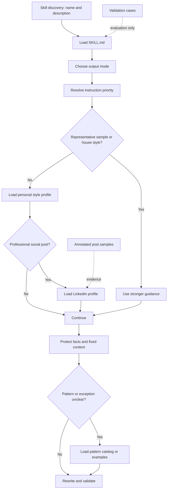

# Skill Analysis: Personal Humanizer

## Scope and evidence

This analysis covers the eight original skill and supporting source files in the workspace. The generated documents under `docs/` organize the findings and reusable guidance; they are not runtime components of the skill. Statements marked **Observed** come directly from the analyzed source files. Statements marked **Platform requirement** come from the installed VS Code Agent Skills reference. **Recommendation** identifies proposed improvements rather than current behavior.

## Directory layout

```text
Humanizer_Agent/
|-- .github/
|   `-- skills/
|       `-- personal-humanizer/
|           |-- SKILL.md
|           `-- references/
|               |-- examples.md
|               |-- linkedin-style-profile.md
|               |-- output-modes.md
|               |-- pattern-catalog.md
|               |-- personal-style-profile.md
|               `-- validation-cases.md
|-- docs/
|   |-- skill-analysis/
|   |   `-- SKILL_ANALYSIS.md
|   `-- skill-development/
|       |-- REUSABLE_SKILL_TEMPLATE.md
|       `-- SKILL_BUILDING_GUIDELINE.md
`-- my_personal_socialmedia_posts_examples.txt
```

No `scripts/`, `assets/`, package manifest, automated test runner, validation log, or workspace-level Copilot instruction file is present.

## Component inventory

| File | Observed purpose | Loading/use | Status |
|---|---|---|---|
| `.github/skills/personal-humanizer/SKILL.md` | Discovery metadata, scope, priorities, workflow, defaults, hard limits, and resource routing | Loaded when its description matches a request or the skill is invoked | **Platform-required** |
| `references/output-modes.md` | Return contracts for pasted text, file edits, embedded text, and review-only requests | Read when the response contract is unclear | Optional platform component; operationally conditional |
| `references/personal-style-profile.md` | Provisional general voice baseline and evidence-quality scheme | Used when no stronger sample or house style is available | Optional platform component; operationally conditional |
| `references/linkedin-style-profile.md` | Professional-social overlay for voice, structure, length, and formatting | Used only for LinkedIn or similar professional social posts | Optional and domain-specific |
| `references/pattern-catalog.md` | Context-sensitive diagnostic taxonomy with actionability and exceptions | Consulted when a suspected pattern needs diagnosis | Optional and domain-specific |
| `references/examples.md` | Constructed before/after cases that demonstrate judgment rules | Consulted when instructions still leave a decision ambiguous | Optional and domain-specific |
| `references/validation-cases.md` | Fifteen manual evaluation fixtures and recording fields | Used to evaluate or refine the skill, not for ordinary rewrites | Optional quality-assurance component |
| `my_personal_socialmedia_posts_examples.txt` | Ten annotated social-post samples; Posts 5, 6, and 10 are marked fully user-written | Evidence source for social voice claims | Supporting source, but currently outside the skill bundle |

## Architecture and control flow



The main file owns decisions and sequencing. References separate stable subcontracts, contextual profiles, detailed heuristics, examples, and evaluation fixtures so they can be loaded only when needed.

## Observed formats and conventions

- `SKILL.md` has YAML frontmatter with the required `name` and `description` fields. Its `name` exactly matches the `personal-humanizer` folder.
- The description states the capability, likely trigger phrases, available context, and exclusions. This is the skill's discovery surface.
- The body follows a decision-oriented order: purpose, priorities, output mode, workflow, gotchas, defaults, content-type guidance, hard limits, and resources.
- Relative Markdown links use `./references/<file>.md` from `SKILL.md` and sibling filenames inside `references/`.
- The workflow uses progressive disclosure: core behavior stays in `SKILL.md`; detailed material is loaded conditionally.
- Rules distinguish priorities, defaults, and absolute limits. This prevents preferences from overriding factual fidelity.
- Profile claims carry evidence labels: `Direct preference`, `Authored-sample pattern`, `Mixed-sample hypothesis`, and `Provisional default`.
- Heuristics include purpose, actionability, and exceptions instead of acting as a forbidden-word list.
- Examples use `Before`, `After`, and a short rationale. Validation fixtures use request, input, invariants, expected behavior, and unacceptable outcomes.
- The source corpus adds `Audience`, `Purpose`, and authorship metadata, allowing stronger evidence to outrank AI-assisted samples.

## Required versus optional

### Platform requirements

- A skill directory in a supported location, here `.github/skills/<skill-name>/`.
- A `SKILL.md` file in that directory.
- YAML frontmatter containing `name` and `description`.
- A lowercase alphanumeric-and-hyphen `name` of 1-64 characters that matches the folder name.
- A meaningful description, up to 1024 characters, that explains what the skill does and when it should load.

The body must provide enough procedural knowledge to perform the task. Exact heading names such as `Workflow`, `Priorities`, and `Hard limits` are not platform-mandated.

### Platform-optional components

- Frontmatter fields such as `argument-hint`, `user-invocable`, and `disable-model-invocation`.
- `references/`, `scripts/`, and `assets/` directories.
- Profiles, examples, output modes, validation fixtures, sample corpora, and any particular section hierarchy.

### Required by this skill's own design

The six reference files are not platform requirements, but linked instructions make them conditionally necessary for the documented behavior. For example, removing `output-modes.md` would break the promised detailed return contract; removing `linkedin-style-profile.md` would break the professional-social branch. `validation-cases.md` is needed only for evaluation. The root sample corpus is evidence for profile claims, not runtime input for every rewrite.

## Confirmed gaps and uncertainties

1. **Broken source filename:** `linkedin-style-profile.md` cited `my_personal_socialmedia_posts.txt`, but the matching workspace file is `my_personal_socialmedia_posts_examples.txt`. The profile now links to the existing corpus.
2. **Source outside the bundle:** the corpus is at workspace root, not under the skill directory. It is not linked from `SKILL.md`, so the bundle is not fully portable or self-contained.
3. **Provisional general profile:** the workspace explicitly says it lacks enough fully user-written emails, internal messages, and project updates. Social-post evidence should not be generalized beyond that context.
4. **Manual validation only:** fixtures define reproducible checks, but no runner, result log, baseline, or prior execution evidence exists.
5. **No version marker:** validation asks reviewers to record a skill version or commit, but no version field or changelog exists. A Git commit can satisfy this when the workspace is version-controlled; that is not established by the files scanned.
6. **Invocation settings are implicit:** omitted `user-invocable` and `disable-model-invocation` fields use platform defaults. This is valid, but the intended slash-command and automatic-loading policy is not stated locally.
7. **External factual quality is unevaluated:** the sample posts contain technical claims, but this skill explicitly excludes fact-checking. This scan therefore treats them only as style evidence.

## Recommendations

- Move the annotated corpus into `references/` or another directory inside the skill, rename citations to the actual filename, and link it explicitly from the profiles that depend on it.
- Keep the corpus out of ordinary runtime loading; it is evidence material, not a required context file for every rewrite.
- Add a small validation-results template or automated invariant checker if regression tracking matters.
- Add `user-invocable` and `disable-model-invocation` explicitly when invocation policy should be reviewable rather than defaulted.
- Expand the general personal profile only after collecting representative, clearly attributed non-social samples.